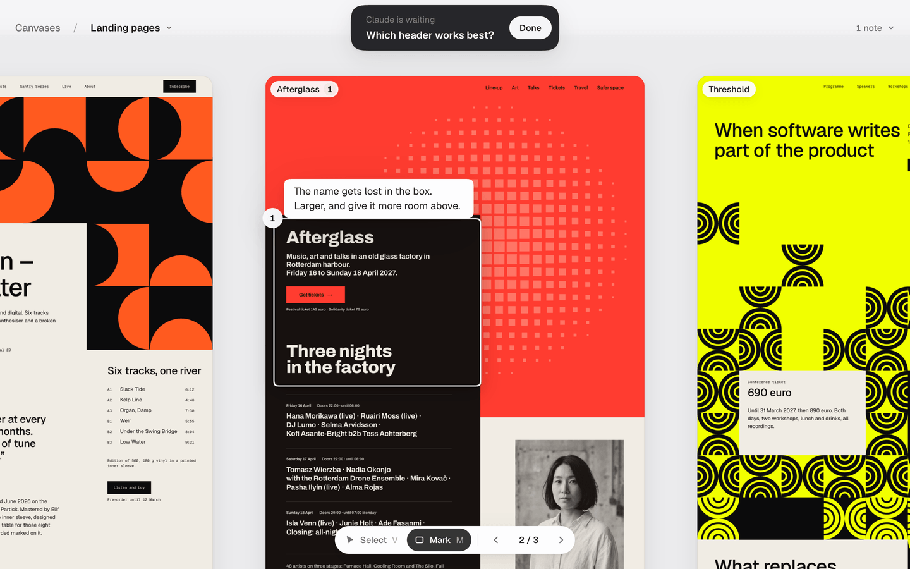
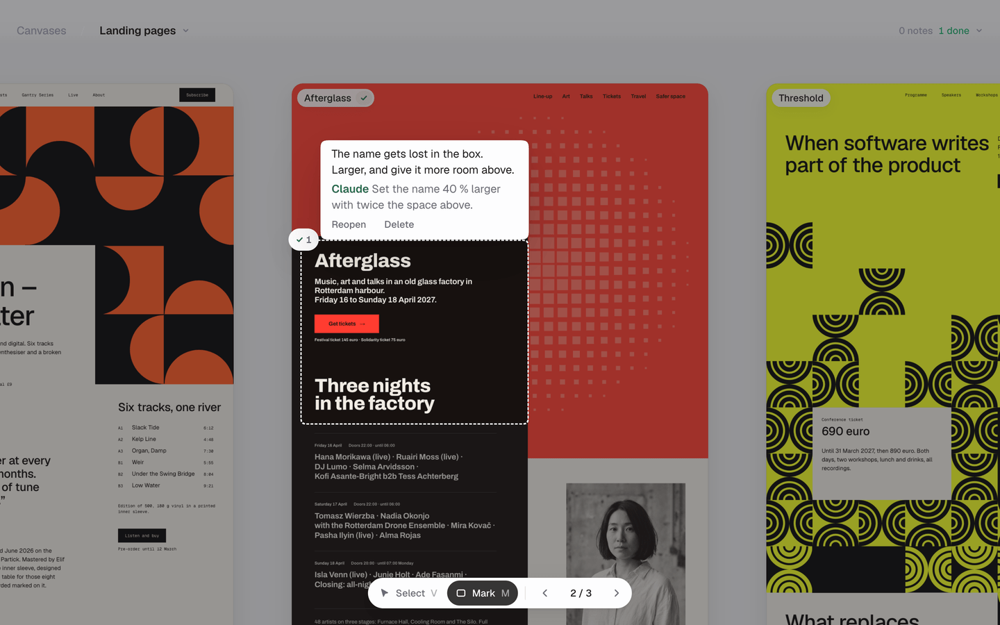
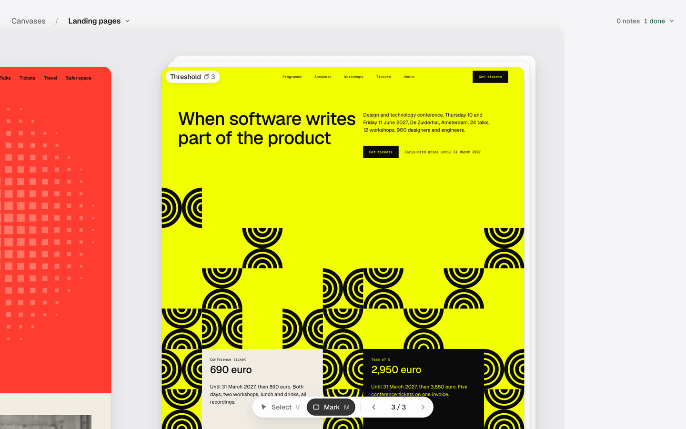

# Sideview

A canvas next to your coding agent's thread. Your coding agent puts screenshots on it – of a website, a Figma frame, your app. You zoom in, frame the spots that bother you, type or speak a note, and click **Done**. The coding agent gets every note with a crop of the spot, fixes what you asked for, and checks each note off with a one-line reply.

It is a small macOS app with a local MCP server. Everything stays on your Mac.



> Status: alpha. A personal tool, used every day by one person; a test with other users is still missing. It may not work for you. Issues are welcome, support is not promised.

## Install

You need macOS, [Node](https://nodejs.org) 24 or newer and [Claude Code](https://claude.com/claude-code).

```bash
npx github:threeaio/sideview
```

This copies the app to `~/Library/Application Support/Sideview/app`, registers the MCP server `sideview` with Claude Code for all your projects (it asks first), and starts the app. Start a new Claude Code session afterwards so it sees the new tools.

Later: `npx github:threeaio/sideview status`, `… start`, `… uninstall` (your canvases stay). Running the first command again updates the app.

## Use

Say "Sideview" (or "canvas") to your coding agent and point at material:

- *"Put the screenshots in ./shots on the canvas."*
- *"Take full-page screenshots of example.com, desktop and mobile, and open them on the canvas. Let's review the header."*
- *"Open this Figma section on the canvas: https://www.figma.com/design/…"* (needs the Figma MCP connector)

Then, in the canvas:

| What | How |
|---|---|
| Zoom | pinch, or ⌘ + scroll; ⌘+ / ⌘– ; ⌘0 is 100 %; Shift+1 shows everything |
| Pan | two fingers, scroll, or hold Space and drag |
| Frame a spot | Shift + drag, or drag with the Mark tool (M). Type a note, Enter saves |
| Pin a point | click an image with the Mark tool |
| Next / previous image | → / ←, or the arrows in the toolbar |
| Send to the coding agent | **Done** at the top (or say "done"). Forgot it while the agent waits? Stop the wait (Esc in Claude Code) and tell it to look at the canvas |
| Mark as done / reopen | select a note, **Done** / **Reopen**; the coding agent does this itself after fixing something |
| Undo | ⌘Z, ⌘⇧Z |
| Table of contents | click the canvas name or press I |
| All notes | click the counter top right or press A |
| All canvases | "Canvases" top left, ⌘O; new canvas ⌘N |
| Drop or paste images | drag image files onto the canvas, or ⌘V |

Once the coding agent has fixed something, it checks the note off with a one-line reply. The note stays on the canvas, so you can see what was done and reopen it.



When the coding agent replaces an image with a revised version, the old versions stay stacked behind it. Click the stack icon on the image's label (or say “compare versions”) to see an earlier version and the current one side by side: zooming and scrolling move both, and each side shows the notes made on it. An earlier version you no longer need can be deleted there, together with its notes (undo brings both back).



## Voice (optional)

Hold **Option (⌥)** and speak: "overview", "next", "show me the header", "go down", "note three", dictate a note, "rename group", "done". In the comparison of versions: "version one", a section's name, "note two". German works as well as English (Settings → Language).

Voice has two parts. Speech recognition is needed for voice at all; Jev is recommended on top.

### 1. Speech recognition (needed for voice)

It runs locally with [whisper.cpp](https://github.com/ggml-org/whisper.cpp):

```bash
brew install whisper-cpp ffmpeg
mkdir -p ~/.cache/whisper-cpp
curl -L -o ~/.cache/whisper-cpp/ggml-large-v3-turbo-q5_0.bin \
  https://huggingface.co/ggerganov/whisper.cpp/resolve/main/ggml-large-v3-turbo-q5_0.bin
```

Restart the app. Now dictation works, and commands work when you say their exact wording ("overview", "note three").

### 2. Understanding commands with Jev (recommended)

People rarely say the exact wording. "Go back to the one with the pricing table", a different word order, a word whisper heard slightly wrong: Sideview hands such sentences to [Jev](https://docs.typesafe.ai), a small, fast decision model by TypeSafe. Jev picks the matching command from what is on screen right now. Without Jev, Sideview only understands the exact wording and otherwise shows "No Jev key, fixed commands only".

1. Create an account and an API key in the [TypeSafe console](https://console.typesafe.ai/keys).
2. In Sideview, open Settings (⌘,) → Understanding commands and paste the key. It is stored in the macOS Keychain, not in a file. (Alternatively set `TYPESAFE_API_KEY` in the environment the app starts from.)

Costs are small: only sentences that don't match exactly go to Jev, in daily use about 0.02 US cents each. Settings → Costs shows what it has cost you so far. Only the transcribed sentence and the names of the options on screen are sent; audio never leaves your Mac.

Any service with the same API (`POST /v1/systemone`) works too: set its address and model in the same place, e.g. a local [Kev](https://github.com/jaredpalmer/kev) (its model cards list English only).

The commands and their wording fit how I talk. Yours will differ – see [Make it yours](#make-it-yours).

## Website screenshots

Sideview reads `regions.json` next to a screenshot and then knows the header, sections and footer by name ("show me the pricing section"). The companion skill [page-shots](https://github.com/threeaio/page-shots) takes such screenshots: desktop and mobile, cookie banners declined, lazy images loaded. It is optional; any image works.

## Other MCP clients

The server is a plain stdio MCP server. Add it to any client:

```json
{ "mcpServers": { "sideview": { "command": "node", "args": ["~/Library/Application Support/Sideview/app/src/mcp/server.ts"] } } }
```

(Use absolute paths; `npx github:threeaio/sideview status` prints them.) `sideview_review` waits until you click Done. Clients without progress notifications get a "still open" answer after 45 seconds and simply call again; nothing is lost. Tested with Claude Code.

## Tools

`sideview_open`, `sideview_review`, `sideview_get`, `sideview_list`, `sideview_resolve_annotations`, `sideview_remove_annotations`, `sideview_remove`, `sideview_remove_versions`. Canvases are stored as [JSON Canvas](https://jsoncanvas.org) files in `~/Library/Application Support/Sideview/canvases`, notes as extra fields.

## Extensions (experimental)

There is a small extension point, built for one private add-on (a search in a personal image library) and kept because it was cheap. Drop a folder into `extensions/<name>/` and rebuild: it can add a layer to the UI, its own IPC channels, image origins for the MCP server and terms for speech recognition (`src/shared/extensions.ts`). It is not a plugin system: extensions import app internals, there is no stable API, they run with the app's full rights, and the UI part is bundled at build time. Expect it to change.

## Make it yours

Sideview is built around how I work. You work differently, and you already have a coding agent. So fork it and let your coding agent adapt it to you. The license allows that.

Voice is where this pays off most. Which commands you need, and which words you actually say for them, differs from person to person. Expect to tune it:

- Every command's phrases are in `src/shared/i18n/en.ts` and `de.ts` (`cmd.<name>.phrases`). Add the words you say, remove the ones that misfire. An exact phrase wins over everything else, so a short phrase hidden inside a longer one ("back" in "further back") is the usual cause of a wrong action.
- The routing core is `src/shared/voice.ts`. `src/shared/voice.test.ts` runs the real phrases, so a new collision shows up as a failing test.
- Every spoken command is logged, with what was heard and what ran, in `~/Library/Application Support/Sideview/logs/commands.jsonl`. Hand that file to your coding agent and ask what to change.

Adding a voice command takes four steps. A component registers its commands with `useVoiceCommands` (`src/renderer/features/voice/registry.ts`); look at `useCanvasVoice.ts` for many examples. Each command has an `id`, a `meaning` (one sentence the decision model reads when the words don't match exactly), its `phrases` from the language files, and `run`, the same handler the button uses. The button gets `data-option="<id>"`; a button without a voice command shows up as a warning in the console. Last, add the command to the routing test in `src/shared/voice.test.ts`, which checks that every phrase reaches its own command.

The same goes for everything else: shortcuts, the toolbar, what a note looks like. Install your fork the same way: `npx github:<you>/sideview`.

## Development

```bash
git clone https://github.com/threeaio/sideview && cd sideview
npm install
npm run app          # builds the UI on install; runs on port 4730 with data in ./data
npm test && npm run typecheck
node scripts/check-npx.mjs   # the install path end to end, offline, with a fresh home folder
npm run check:labels         # note numbers and cards at every zoom level, expects 0 problems
```

Code comments are partly German; the app speaks both.

## License

[PolyForm Shield 1.0.0](LICENSE): free to use, change and share, also at work and in companies. Not allowed: building a product or service from it that competes with Sideview.
